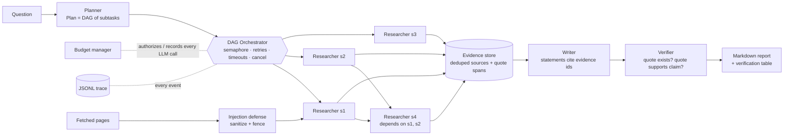

# Multi-Agent Research Crew

**Ask a question. A planner splits it up, parallel researchers read the web, a writer drafts a cited report, and a verifier throws out every claim it cannot tie to a stored quote.**

Built from scratch on `asyncio` and Pydantic v2. The orchestrator, budget manager, evidence store and verifier are about 1,600 lines of original code, with no CrewAI, LangGraph or agent framework underneath. Runs fully offline in `DEMO_MODE`.

```bash
pip install -e ".[dev]" && crew run --demo "How do RAG and long-context models compare?" --out report.md
```

## Architecture



Each researcher runs: **queries (LLM) → search → fetch → sanitize → extract claims + verbatim quotes (LLM) → store**. A quote is only stored if it occurs word for word in the fetched text, and the store records its character span.

## Sample output (DEMO_MODE, offline)

Excerpt from `crew run --demo` (demo mode ignores your question and always answers this bundled topic; fixture corpus is synthetic; the mock writer deliberately invents two statements to show the verifier working):

```markdown
## What are the limits and failure modes of long-context models

Accuracy of long-context models is not uniform across the window: several studies report that
information placed in the middle of a long prompt is used less reliably than information at the
start or end[5]. A collection larger than the context window cannot be used at all without some
form of selection or summarisation[5]. ...

## Sources
5. [The Limits of Very Long Prompts](https://longctx.example.com/limits)
   - > Accuracy of long-context models is not uniform across the window: several studies report ...

## Verification

14/16 statements supported by a stored quote; 2 removed.

| # | Statement                                                        | Evidence | Verdict     | Note                                |
|---|------------------------------------------------------------------|----------|-------------|-------------------------------------|
| 9 | Accuracy of long-context models is not uniform across the win…   | E9       | supported   | quote states the claim              |
|15 | RAG outperforms long-context models on every benchmark.          | E1       | unsupported | quote does not support this claim   |
|16 | Hybrid pipelines halve operating costs in all deployments.       | E99      | unsupported | cites unknown evidence ['E99']      |
```

`crew trace` prints the timeline of the same run (the `llm_call` lines and `$` figure in demo mode use a simulated price):

```text
run ab77a398 | 54 events | 0.12s
+  0.011s  planner          repair             role=planner attempt=1 error=JSON parse error: Illegal trailing comma ...
+  0.022s  researcher:s1    node_start         attempt=1
+  0.022s  researcher:s2    node_start         attempt=1
+  0.022s  researcher:s3    node_start         attempt=1
+  0.047s  researcher:s3    injection_flagged  url=https://cheap-llm-tips.example.net/rag-vs-context removed=2 ...

agent spans
  planner          |#######                                 | 0.02s
  researcher:s1    |       #############                    | 0.04s
  researcher:s2    |       #############                    | 0.04s
  researcher:s3    |       ##############                   | 0.04s
  researcher:s4    |                     ##########         | 0.03s
  writer           |                                ###     | 0.01s
  verifier         |                                    ### | 0.01s
```

## Quick start

```bash
python -m venv .venv && . .venv/bin/activate
pip install -e ".[dev]"            # [api] extra only if you want the SSE server

# Offline, no keys needed
crew run --demo "How do RAG and long-context models compare?" --researchers 4 --out report.md
crew trace                          # timeline of the latest run

# Real run
cp .env.example .env                # set ANTHROPIC_API_KEY and one search key
crew run "What are the trade-offs of vector databases vs. Postgres pgvector?" --researchers 4 --out report.md --budget-tokens 150000

# Streaming API (SSE)
crew serve                          # GET /research/stream?question=...&researchers=4

# Tests / lint
pytest -q && ruff check . && ruff format --check .

# Docker
docker build -t research-crew . && docker run --rm -p 8000:8000 -e DEMO_MODE=1 research-crew
```

In demo mode the mock planner and fixtures always answer the bundled RAG-vs-long-context topic, whatever question you pass.

## Configuration

| Variable | Default | Purpose |
|---|---|---|
| `DEMO_MODE` | `0` | `1` = mock LLM + fixture search/fetch, no network |
| `ANTHROPIC_API_KEY` | - | Required unless demo |
| `CREW_MODEL` | `claude-sonnet-5-5` | Model id sent to the Anthropic API (also `crew run --model`) |
| `CREW_SEARCH_PROVIDER` | `tavily` | `tavily`, `brave` or `serpapi` |
| `TAVILY_API_KEY` / `BRAVE_API_KEY` / `SERPAPI_API_KEY` | - | Key for the chosen provider |
| `CREW_BUDGET_TOKENS` | `200000` | Global token budget (also `--budget-tokens`) |
| `CREW_BUDGET_USD` | unset | Optional global dollar cap (also `--budget-usd`) |
| `CREW_TRACE_DIR` | `.crew/runs` | Where `<run-id>.jsonl` traces are written |

## Design decisions

- **Own orchestrator, not a framework.** `orchestrator.py` (~170 lines) is a topological DAG runner: one task per node, a shared `asyncio.Semaphore` for the concurrency cap, `asyncio.timeout` per attempt, exponential backoff with jitter, and a `NonRetryable` marker for errors that must not be retried (budget exhaustion). The semaphore slot is released while a node backs off so a flaky node cannot stall the pool. `cancel()` and outer task cancellation both reach every node; the SSE endpoint relies on this when a client disconnects.
- **Planner output is a DAG, validated.** `Plan` rejects duplicate ids, unknown dependencies and cycles at parse time, so a bad plan goes through the repair loop instead of deadlocking the scheduler. Dependent researchers receive their dependencies' claims as context.
- **Failure policy: degrade, don't die.** Researchers are `optional` for the writer, so one failed researcher yields a thinner report with a note, not a crash. Writer and verifier failures are fatal.
- **Evidence before prose.** Claims enter the store only with a verbatim quote and character span, so the writer can cite only things that exist. Sources are deduplicated by canonical URL (tracking params, `www`, fragments, trailing slash) and then by normalized content hash (mirrors).
- **Two-stage verification.** Mechanical checks come first and cost nothing: statement has citations, every cited id exists, stored quote still matches its source span. Then one batched LLM entailment call per report decides whether the quotes support the statement. If the budget runs out, the verifier falls back to a lexical-overlap check and says so in the table.
- **Budget as a first-class resource.** Every LLM call goes through `BudgetedLLM`, which reserves worst-case tokens (prompt estimate plus `max_tokens`) before the call and settles actual usage after. Researchers may spend only 65% of the budget; the rest is reserved for writer and verifier. Degradation ladder: fewer researchers, then fewer subtasks, then shorter per-source context (6000, 2500, 1000 chars) and a smaller evidence set for the writer, then lexical verification.
- **Structured output with repair.** The Anthropic backend forces a tool call whose `input_schema` is the Pydantic JSON schema. Whatever comes back is still validated; on failure the model sees its own reply plus the validation error and retries (default 2 repairs). Every repair is a trace event.
- **Prompt-injection defense in depth.** (1) Strip invisible characters and HTML comments. (2) Remove sentences that look like instructions or exfiltration. (3) Fence each page in a nonce-delimited `<untrusted_source>` block that the system prompt declares to be data. (4) Do not trust the model's output: claims must pass schema validation, cite a URL that was actually fetched, and quote the sanitized text verbatim; suspicious claims are rejected. (5) Fetching has an SSRF guard (public addresses only, re-checked on every redirect; IPv4-mapped IPv6 and link-local/metadata addresses blocked) and a size cap. The check resolves DNS separately from the HTTP client, so DNS rebinding is not fully closed. Researchers have no side-effecting tools, so a successful injection has little to act on.
- **Tracing is the debugger.** Every node start/retry/failure, LLM call (tokens), repair, rejected quote and injection flag is a JSONL line; `crew trace` renders a timeline and per-agent spans.

## Project layout

```
crew/
  orchestrator.py  DAG runner      budget.py     token/USD budget + BudgetedLLM
  agents.py        planner/researcher/writer      verifier.py   claim verification
  pipeline.py      run_crew()      store.py      evidence + dedupe
  structured.py    JSON repair     safety.py     injection defense
  llm.py           LLM interface   tools.py      search/fetch (real + fixtures)
  tracing.py       JSONL + timeline  report.py   markdown rendering
  cli.py / api.py  Typer CLI, FastAPI SSE        demo.py + fixtures/  offline mode
tests/             45 tests: concurrency, timeouts, cancel, budget, repair, verifier, e2e, SSE
```

## Limitations

- The Anthropic client and the Tavily/Brave/SerpAPI/HTTP fetch paths are covered by mocked-transport tests only; they have not been run against live services in this repo's CI.
- Demo mode uses a deterministic mock LLM with a synthetic corpus. Its verifier is lexical, so it demonstrates the pipeline, not model quality. The mock writer injects two bad statements on purpose.
- Verification checks that a quote supports a statement, not that the source is true or authoritative. There is no source-quality ranking.
- Token counts for budgeting are estimated as characters / 4 before a call; actual usage is recorded after. Parallel calls can overshoot slightly only by the difference between estimate and actual.
- Single process, in memory: no persistence of the evidence store, no resumable runs, no auth or rate limiting on the SSE endpoint. JavaScript-rendered pages and PDFs are not handled by the fetcher.
- Pricing for cost display is a small built-in table; override it if your model differs.

## License

MIT, 2026 Hussain.
